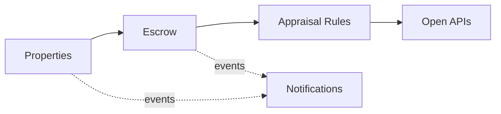

# Domain Model and Bounded Contexts

Ubiquitous language and context design (view VP-4). Domain-standard concepts are mapped
normatively in `../domain/domain-standards.md` (CR-5).

## Ubiquitous language (selected terms)

| Term | Meaning |
|---|---|
| **Property** | A residential, commercial, land or industrial property; its registry reference is masked |
| **Escrow account** | A property transaction's guarded escrowed amount, in minor units |
| **Escrow release** | One release from escrow (deposit, inspection, closing, repair) |
| **Appraisal rule** | A decision rule binding a property type to value and valuation-gap envelopes |
| **Lease template** | A residential, commercial or short-term lease template |
| **Property risk score** | A transparent 0-100 title/market/condition risk score |

## Bounded contexts and invariants

### Properties — `property-service`
Property registry; the land-registry reference is masked at listing. Lifecycle: `LISTED` → transitions
reserve, close. Land-registry references are validated at listing and never stored or returned in clear — only a masked form is kept. Parties' personal data stays in adopter CRM/legal systems; all data here is synthetic.

### Escrow — `escrow-service`
Guarded escrow accounts per property transaction and the releases against them. **Invariant (ADR-0004): releases from a property's escrow account never exceed the escrowed amount — a release that would overrun it is rejected (422) and records nothing; closings are always fully evidenced.** Consumption records are
append-only evidence; a rejected operation records nothing.

### Appraisal Rules — `appraisal-rules-service`
Decision rules binding property types to value caps and valuation-gap envelopes. Only ACTIVE rules decide; evaluation order is by priority; every decision
is ALLOWED / DEGRADED / DENIED with the matched rule and a human-readable reason.

### Lease Templates — `lease-template-service`
Lease template catalogue by type and term.

### Notifications — `notification-service`
Delivery trail for audit; recipients are never logged.

## Context map

